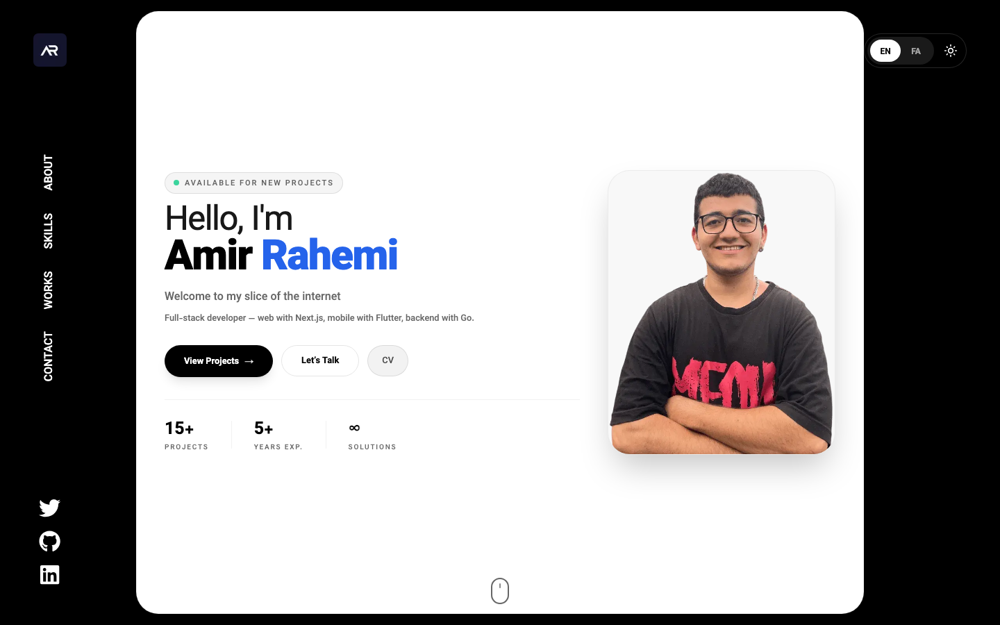
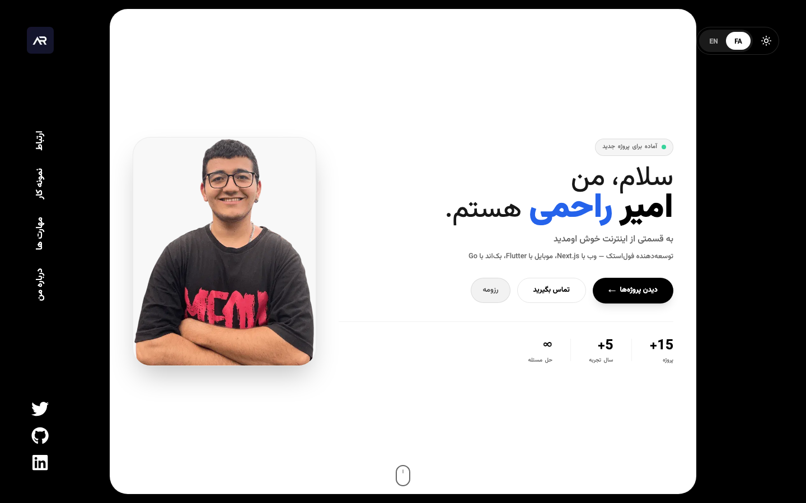

<h1 align="center">Amir Rahemi — Portfolio</h1>

<p align="center">A bilingual (English / Persian) developer portfolio built with Next.js.</p>

- English at `/`, Persian (right-to-left) at `/fa`
- Pages are pre-rendered, so search engines and link previews (Telegram, LinkedIn, WhatsApp) see real titles and images
- Light and dark theme (follows the system until you choose)
- Contact form: sends an email (EmailJS) and an instant Telegram alert
- Responsive from 320px up

## Demo

- [amirrahemi.com](https://amirrahemi.com/)

## Screenshots

<div>
  
</div>
<div>
  
</div>

## Run it

```bash
git clone https://github.com/amirrahemi01/portfolio.git
cd portfolio
npm install
cp .env.example .env.local   # then fill in the values
npm run dev                  # http://localhost:3000
```

| Command | What it does |
| --- | --- |
| `npm run dev` | Development server |
| `npm run build` | Production build |
| `npm start` | Serve the production build |
| `npm run og` | Regenerate the social preview images in `public/og/` (needs Google Chrome) |
| `npm run cv` | Rebuild `public/AmirRahemiCV.pdf` from `scripts/cv/cv.html` (needs Google Chrome) |

## Environment variables

See [.env.example](.env.example). In short:

- `NEXT_PUBLIC_EMAILJS_SERVICE_ID`, `NEXT_PUBLIC_EMAILJS_TEMPLATE_ID`, `NEXT_PUBLIC_EMAILJS_PUBLIC_KEY` — EmailJS (public by design). The old `REACT_APP_EMAILJS_*` names still work.
- `TELEGRAM_BOT_TOKEN`, `TELEGRAM_CHAT_ID` — **secret**, server-side only. Set them in Vercel (Project → Settings → Environment Variables) and in `.env.local`. Never commit them.

The EmailJS email template is in [emailjs/contact-template.html](emailjs/contact-template.html).

## Changing the content

| What | Where |
| --- | --- |
| Texts (both languages), SEO titles and descriptions | `src/assets/locale/en/translation.json` and `.../fa/translation.json` |
| Projects (titles, descriptions, links, screenshots, tech stack, optional write-up and demo video) | `src/data/projects.ts` |
| Hero numbers, email, Telegram link, CV path | `src/data/site.ts` |
| Skills icons | `src/components/Skills.tsx` |
| Social links | `src/components/ContactUs.tsx` |

After changing project or home text, run `npm run og` and commit the new images in `public/og/`.
Update `public/sitemap.xml` when you add pages.

## How it is organised

```
src/
  app/[lang]/        every page lives under /en or /fa (src/proxy.ts hides the /en prefix)
    page.tsx           home
    projects/[slug]/   project pages
    not-found.tsx      the 404 page
  app/api/contact/   Telegram alert endpoint (server side)
  components/        UI
  data/              projects and site content
  i18n/              language context + translation helper
scripts/generate-og.mjs   builds the social preview images
```

## License

MIT — see [LICENSE.txt](LICENSE.txt).
